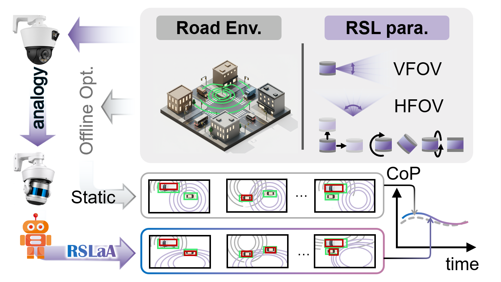

# RSLaA — Roadside LiDARs as Agents

**Self-reconfiguring roadside LiDARs for 3D traffic perception.**

RSLaA treats every roadside LiDAR (RSL) as an agent that re-optimises its pose over
decision-time windows instead of being configured once and left fixed. Because no
ground truth is available at deployment, the framework is driven by a causal,
history-only **surrogate metric** computed from a probabilistic occupancy grid (POG).
The repository contains the LiDAR simulator, the surrogate-metric benchmark, the MPC
and MAPPO controllers, and the full evaluation pipeline used in the paper.

<p align="center">
  <a href="html/index.html"></a>
</p>

<p align="center">
  <a href="html/index.html">Project page</a> ·
  <a href="#benchmark">Benchmark</a> ·
  <a href="#quick-start">Quick start</a> ·
  <a href="#citation">Citation</a>
</p>

---

## Overview

Roadside LiDARs extend the sensing range of connected vehicles and resolve onboard
occlusions at curves and intersections. Existing placement studies optimise a fixed pose
against road geometry and aggregated traffic statistics. Traffic, however, is dynamic:
a placement that is optimal on average can be far from optimal at a given moment.

RSLaA reframes RSL configuration as sequential decision making:

1. **History-only self-evaluation.** Past point clouds are compressed into a POG. Five
   surrogate metrics are computed from this history and used to score candidate poses.
2. **Validated surrogate.** A co-simulation benchmark pairs each candidate with
   detector-agnostic perception labels (IoU, Dev, Comp) measured in the *next* window.
   Multi-view coverage `J_mv` is the most reliable predictor (Pearson r = 0.571, p < 0.05).
3. **Adaptive configuration.** A receding-horizon MPC optimiser and a lightweight
   MAPPO policy (centralised training, decentralised execution) re-aim the sensors at
   every window boundary.

### Key results

Across **10 deployment sites** and **89 six-hour scenarios** (890 runs), adaptive
configuration improves perception over the static baseline with identical initial poses:

| Metric | MPC | MARL (matched) | MARL (mismatched) |
|---|---|---|---|
| IoU | **+5.6%** | **+6.9%** | **+6.1%** |
| Invalid-box rate `I_vR` | **−15.2%** | **−21.6%** | **−18.3%** |
| Centre deviation `Dev` | **−5.8%** | **−3.2%** | **−2.9%** |

The gain is governed mainly by the scene rather than by the controller: it grows with
traffic volume and with the car/truck ratio, shrinks with mean speed, and is maximised
with 15–30 min decision windows and tight pose margins.

---

## Repository layout

```
RSLaA/
├── src/
│   ├── lidarsim/                  # Physics-based multi-LiDAR simulator
│   │   ├── config.py              #   sensor presets (VLP-16, HDL-32E, OS1-64, RS-128)
│   │   ├── trajectory.py          #   Vissim / SUMO trajectory parsing
│   │   ├── pointcloud.py          #   environment point clouds and ground model
│   │   ├── meshes.py              #   vehicle mesh library
│   │   ├── scene.py               #   frame-level scene reconstruction
│   │   ├── scan.py / raycast.py   #   beam generation and GPU/CPU ray casting
│   │   ├── lidar_sim.py           #   multi-LiDAR frame simulation
│   │   ├── lshape.py              #   detector-agnostic IoU / Dev / Comp
│   │   ├── pog.py                 #   probabilistic occupancy grid
│   │   └── viz.py, weather.py, conflict.py, cav.py, opencood_export.py
│   ├── rslaa/                     # Adaptive configuration framework
│   │   ├── common.py              #   I/O, POG construction, simulator factories
│   │   ├── metric_n.py            #   five surrogate metrics (multi-LiDAR)
│   │   ├── mpc_controller.py      #   receding-horizon pose optimisation
│   │   ├── marl_env.py            #   multi-agent environment
│   │   ├── marl_trainer.py        #   MAPPO trainer (PyTorch)
│   │   ├── marl_deploy.py         #   policy deployment
│   │   ├── auto_evaluate.py       #   frame-level evaluation
│   │   ├── sim_pool.py            #   process pool and frame cache
│   │   ├── rslaa_stage1_preprocess.py
│   │   ├── rslaa_stage2_experiment.py
│   │   ├── rslaa_stage3_evaluate.py
│   │   └── rslaa_plot_*.py        #   paper figure generation
│   └── rslaa_bench/               # Surrogate-metric benchmark
│       ├── metrics.py             #   POG and surrogate definitions
│       ├── metric_n.py            #   vectorised multi-LiDAR variants
│       ├── run_benchmark_n.py     #   benchmark construction
│       └── summarize_benchmark.py #   correlation analysis and plots
├── assets/mesh_models/            # Example vehicle meshes (STL)
├── checkpoints/n2_hdl32-vlp16/    # Released MAPPO policies (5 / 15 / 30 min)
├── html/                          # Project page (index.html + assets)
├── pyproject.toml
├── requirements.txt
└── README.md
```

## Installation

Python ≥ 3.10 is required. A CUDA-capable GPU is strongly recommended; the simulator
falls back to CPU when CuPy is unavailable.

```bash
git clone <repository-url>
cd RSLaA
python -m venv .venv
# Windows: .venv\Scripts\activate
source .venv/bin/activate
pip install -e .
```

Optional GPU acceleration (check `nvidia-smi` first):

```bash
pip install cupy-cuda12x      # CUDA 12.x
# pip install cupy-cuda11x    # CUDA 11.x
```

The project page is a static site; open `html/index.html` directly, or publish the
`html/` folder with the included GitHub Pages workflow.

## Data preparation

All experiments consume three inputs:

| Input | Format | Example |
|---|---|---|
| Traffic trajectories | Vissim Vehicle Record `.txt` or SUMO FCD `.xml` | `data/trajectories/` |
| Environment point cloud | `.ply` (x/y/z, optional rgb) or `.h5` | `data/pointclouds/` |
| Vehicle meshes | `.stl` / `.ply` / `.obj` | `assets/mesh_models/` |

The public sample meshes are only intended for smoke tests. Point-cloud sites from
KITTI-360 and WHU-Urban3D are not redistributed; download them from the original
sources and set:

```bash
# PowerShell
$env:RSLAA_POINTCLOUD="D:\datasets\pointclouds"
$env:RSLAA_TRAJECTORIES="D:\datasets\trajectories"
$env:RSLAA_RESULTS="D:\experiments\Results"
```

The stage scripts resolve these paths at import time; every CLI also accepts explicit
paths.

## Quick start

### 1. Build a surrogate-metric benchmark

```bash
python -m rslaa_bench.run_benchmark_n \
    --traj "data/trajectories/scene_001/参数 (1).txt" \
    --env data/pointclouds/0940.h5 \
    --models assets/mesh_models \
    --out bench_out/scene_001/traffic_01 \
    --window-min 5 --n-lidar 3
```

Each decision window writes `data_<tag>.json` (surrogates + perception labels),
`pog_<tag>.npz`, `lidar_para_<tag>.json` and `traffic_<tag>.txt`.

Summarise correlations across a benchmark tree:

```bash
python -m rslaa_bench.summarize_benchmark --root bench_out
```

Outputs (`summary_*.csv`, `correlations_all.csv`, `corr_scatter_all.png`) are written to
`bench_out/_summary`.

### 2. Run MPC

```bash
python -m rslaa.mpc_controller \
    --pose-json pose.json \
    --traj "data/trajectories/scene_001/参数 (1).txt" \
    --env data/pointclouds/0940.h5 \
    --models assets/mesh_models \
    --out pose_seq_mpc.json \
    --window-min 15 --pos-margin 0.2 --ang-margin-deg 5 \
    --metric J_mv
```

`pose.json` contains the initial configuration:

```json
{
  "presets": ["hdl32", "vlp16"],
  "poses": [[x, y, z, roll, pitch, yaw], [x, y, z, roll, pitch, yaw]],
  "pose_unit": "rad"
}
```

### 3. Train and deploy MAPPO

```bash
python -m rslaa.marl_trainer \
    --traj "data/trajectories/scene_001/参数 (1).txt" \
    --env data/pointclouds/0940.h5 \
    --models assets/mesh_models \
    --presets hdl32,vlp16 --window-min 15 \
    --n-episodes 100 --save-dir checkpoints/my_run
```

```bash
python -m rslaa.marl_deploy \
    --policy checkpoints/n2_hdl32-vlp16/w15/policy_best.pt \
    --pose-json pose.json \
    --traj "data/trajectories/scene_001/参数 (1).txt" \
    --env data/pointclouds/0940.h5 \
    --models assets/mesh_models \
    --out pose_seq_marl.json --window-min 15
```

### 4. Full three-stage experiment pipeline

```bash
python -m rslaa.rslaa_stage1_preprocess --all          # clean sites, static params
python -m rslaa.rslaa_stage2_experiment plan           # balanced experiment plan
python -m rslaa.rslaa_stage2_experiment run --site scene_001
python -m rslaa.rslaa_stage3_evaluate all              # replay + metrics + summary
```

The pipeline expects the layout `Results/scene_XXX/traffic_YY/` and reuses the same
initial poses, sensor suites and traffic data across all four strategies.

## Benchmark

| Item | Value |
|---|---|
| Point-cloud sites | **17** (16 KITTI-360 segments + 1 WHU-Urban3D site) |
| Traffic scenarios | **25** |
| Rolling windows | **2,522** (5 / 15 / 30 min) |
| Decision windows | **2,449** |
| Candidate configurations | **14,694** (6 per decision window, 2–3 LiDARs) |
| Surrogate × perception pairs | **211,938** valid (220,410 total) |
| Surrogates | `J_EIG`, `J_cov`, `J_mv`, `J_dyn`, `J_traj` |
| Perception labels | IoU, Dev, Comp (detector-agnostic) |

Benchmark sites and deployment sites are disjoint, so surrogate selection and method
evaluation never share data.

## Evaluation protocol

* **IoU** — mean 3D IoU over valid detections; missed objects count as 0.
* **Dev** — median bottom-centre XY error over valid detections (metres).
* **I_vR** — fraction of produced boxes that fail the validity test (TP: association
  plus 3D IoU > 0.15).
* **Composite score** — `0.4·IoU + 0.3·(1 − clip(Dev, 0, 2)/2) + 0.3·(1 − I_vR)`.

All runs of a scenario share initial poses, sensor models, traffic data and evaluation
parameters, so differences are attributable to the deployment strategy alone.

## Project page

The Apple-inspired bilingual (EN / 中文) project page is in [`html/index.html`](html/index.html).
It uses only static assets; images and the teaser video live in `html/assets/`.
GitHub Pages deployment is automated by `.github/workflows/pages.yml`, which publishes
the `html/` folder.

## Citation

```bibtex
@article{rslaa2026,
  title   = {RSLaA: Self-Reconfiguring Roadside LiDARs as Agents for 3D Traffic Perception},
  author  = {Ma, Yang and others},
  journal = {arXiv preprint},
  year    = {2026},
  note    = {Paper link to be added}
}
```

## Contact

* Yang Ma — mayang@hfut.edu.cn
* Hefei University of Technology
* Metropolitan University, Canada

## License

Released under the [MIT License](LICENSE). Third-party datasets (KITTI-360,
WHU-Urban3D) remain subject to their original licenses.
